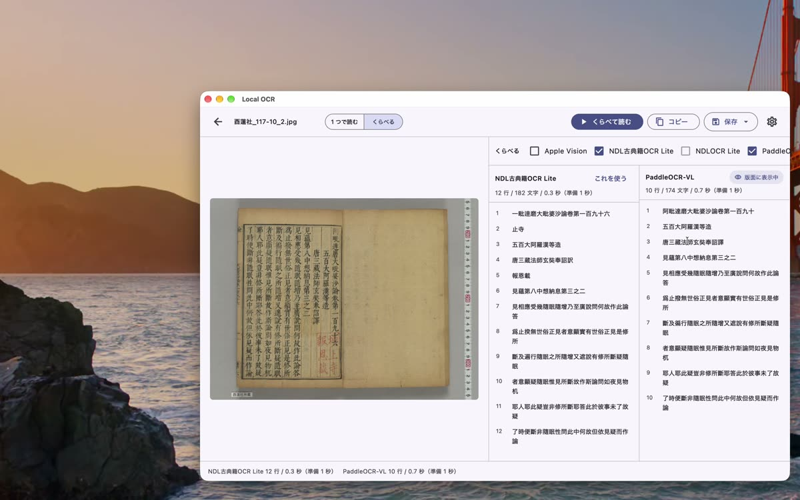

版 0.1.11 からの機能です。
Windows 版はストアが自動で新しい版に替えます。Mac 版は [Releases](https://github.com/nakamura196/local-ocr/releases/latest) から入れ替えてください。

### 動画で見る

漢籍の 1 頁を PaddleOCR-VL と PP-OCRv6 で読み、色の付いた字を版面と見くらべています（1 分 20 秒、声と字幕つき）。

<iframe src="https://www.youtube-nocookie.com/embed/qpshKA_eGCk?rel=0" title="Local OCR で 2 つの読む道具をくらべる" style="width:100%;aspect-ratio:16/9;border:0" allow="encrypted-media; picture-in-picture; fullscreen" allowfullscreen loading="lazy"></iframe>

### 何が変わったか

画面上の「くらべる」を押し、2 つ以上の読む道具にチェックを入れて読みます。
読み方の違う字に、黄色い背景と下線が付きます。
色の付いていない所は、どの道具も同じに読んでいます。

- 「使用中」の列では、ほかの道具のどれかと違う字に色が付きます
- ほかの列では、「使用中」の結果と違う字に色が付きます
- 各列に「一致 96%」のような一致率と、異同の字数が出ます
- 色が邪魔なときは、上の「異同に色を付ける」を切ります

### 色が付いた字は、版面で確かめてください

色は「読みが違う」という印です。どちらが正しいかは示しません。
動画の頁では、色の付いた所は次の 3 種類でした。

- **本文の外の文字**: 写真に写った物差しの目盛りや、所蔵のラベルを、片方の道具だけが拾っていました
- **読み違い**: 「機栝」を「機恬」と読むなど。版面を見ると、どちらが正しいか分かります
- **字体の違い**: 「別」と「别」のように、同じ字を別の字体で出したもの。誤りとは限りません

### あわせて変わったこと

コピーと保存に使う結果の札を、「版面に表示中」から「使用中」にしました。
行の位置を返さない読み方（画像に枠が出ないもの）では「使用中（位置なし）」と出ます。

くわしい使い方は [使い方 ─ いろいろな使い方](../guide-more.html) の「くらべる」にあります。
同じ版のほかの変更は [更新履歴](../changelog.html) をご覧ください。
